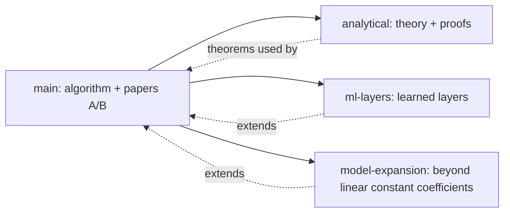

# pde-factor-fit

Reading the **factor structure of a linear PDE** from data. For linear equations with constant coefficients the
natural unit is not the term but the *factor of the symbol*: every Fourier mode of a solution lies on the zero set of
one factor, so the modes fall into groups. This repository holds the theory, the algorithm, the code and the papers.

By **Flavio Pricoco**. Open for everyone to use under permissive licenses; please keep the credit (see [License](#license)).

## Start here

| I want to... | go to |
|---|---|
| read the main paper (one idea first, running example, results) | [`paper/B_proposed_structure/main.pdf`](paper/B_proposed_structure/main.pdf) |
| read the same paper in the analytical-first order | [`paper/A_user_structure/main.pdf`](paper/A_user_structure/main.pdf) |
| see how the two differ | [`paper/COMPARISON.md`](paper/COMPARISON.md) |
| run the algorithm | `pip install -e .` then see [`src/pdefactor`](src/pdefactor) and [`tests/`](tests) |
| read the **explained edition** of the algorithm (46 pp, plain language, every layer with its tests) | [`paper/explained/alg_explained.pdf`](paper/explained/alg_explained.pdf) |
| see benchmarks, experiments and stored results | [`benchmarks/`](benchmarks), [`analysis/exp/`](analysis/exp) |
| see the theory-to-code map (rows T1-T103), limits, parameters, session reports | [`claude/archive/pipeline/`](claude/archive/pipeline), [`claude/archive/sessions/`](claude/archive/sessions) |
| check that nothing of the research repository is missing | [`INVENTORY.md`](INVENTORY.md), [`graphs/`](graphs), [`tools/`](tools) |
| work on it with Claude | [`claude/`](claude) (rules, map, status) |

## Branches

| branch | content | paper |
|---|---|---|
| `main` | the algorithm, tests, benchmarks and the two SIMODS manuscripts | Structure A and B |
| `analytical` | all theory and proofs, **all eleven phases 0-10** (annihilators, factor decomposition, interaction term, identification, systems, variable coefficients, encoder, dictionary, limits) | 57-page paper + the complete 117-page edition and 263-page proof catalogue |
| `ml-layers` | learned layers on top of the pipeline: every layer as designed, built or not, the controller, what worked, what did not, ideas | 21-page paper |
| `model-expansion` | extending the model: nonlinear, variable coefficients, time dependence, systems, non-local; the routes tried; the four founding questions | 13-page paper |

Every branch has the same skeleton: `paper/`, code (`src/`), `tests/` and `benchmarks/`, and a `claude/` folder
with `CLAUDE.md` (rules), `MAP.md` (graph of the branch) and `STATUS.md` (what worked, what did not).
The graph of the whole repository is [`claude/REPO_MAP.md`](claude/REPO_MAP.md).



## Quick start

```bash
pip install -e ".[dev]"
pytest -q                      # full suite is slow (~40 min); tests/test_core_exact.py is quick (optional extras: pip install -e ".[ml,baselines]")
cd paper/B_proposed_structure && latexmk -pdf main.tex
```

## Cite

See [`CITATION.cff`](CITATION.cff) (GitHub shows a "Cite this repository" button).

## License

- Code: MIT, see [`LICENSE`](LICENSE).
- Papers, figures and documentation: CC BY 4.0, see [`LICENSE-papers.md`](LICENSE-papers.md).

Both licenses allow any use, including commercial, and both require that you credit Flavio Pricoco.
