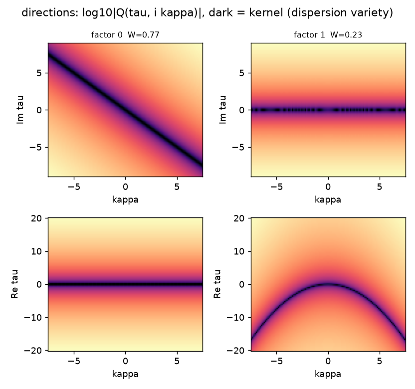
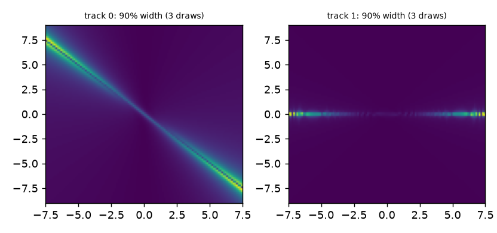
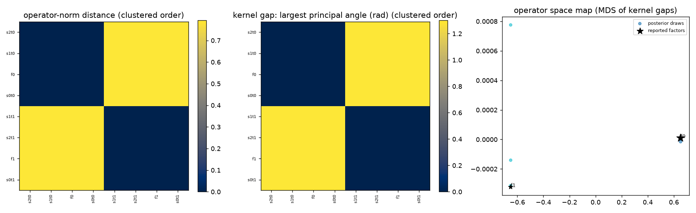
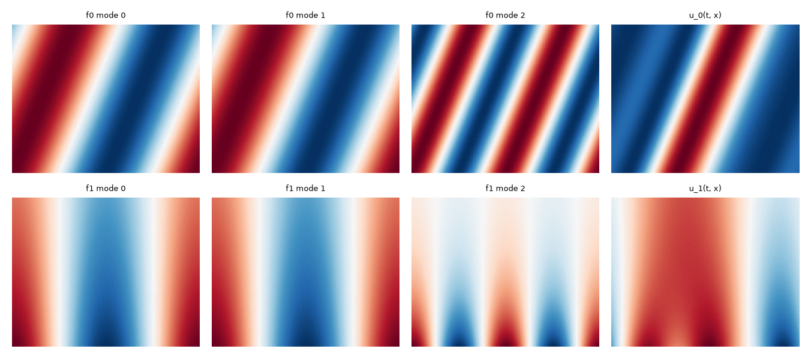
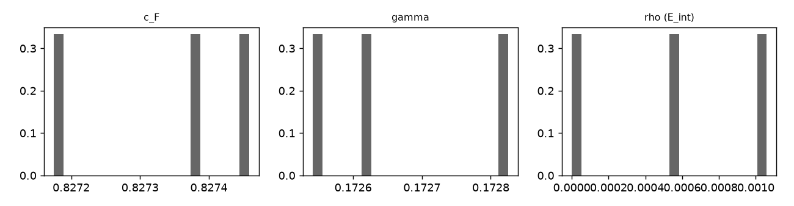

# Final report

## 1. PDE

- equation: `(1.0*tau + 1.0*xi) * (1.0*tau - 0.2997*xi**2) u = 0`
- grid nt×nx = 64×128, T = 2, L = 6.283, sigma = 0.0005292, samples = 3
- truth: `tau + 1.0*xi` · `tau - 0.3*xi**2` — factor set matches: **True** (worst rel. err 0.001054)

## 2. Model chosen

- label: **FIT-COMPATIBLE**
- bounds (m, dx): [3, 4], regrouped: True
- P(k): {'2': 1.0}
- core labels: {'FIT-COMPATIBLE': 1.0}
- dropped as redundant: none
- note: structure ((1, 1), (1, 2)) chosen by data-level evidence; all samples regrouped at it.

| structure | posterior | log evidence |
|---|---|---|
| ((1, 1), (1, 2)) | 1.000 | -782.8 |

## 3. Posterior / distribution

- k_eff = 1.719 (k_det = 2), per sample q05/50/95 = 1.719/1.719/1.72
- P(k) structures {'2': 1.0}; DP {'2': 1.0}; finite-BIC {'1': 0.007562483060479987, '2': 0.9913102429691815, '3': 0.0011269189413381357, '4': 3.550290004933795e-07}
- tracks: W=0.768 `tau + 0.9999923161*xi`; W=0.232 `tau - 0.2996174011*xi**2 + 0.0010512772*xi + 0.0013799621`
- c_F q05/50/95: 0.8272/0.8274/0.8275; gamma: 0.1725/0.1726/0.1728
- cloud size 6; theta_bar and its sd are in report.json

## 4. Factors

### factor 0: `1.0*tau + 0.9999923161*xi`

- W = 0.7679, status: clean (component alone: k=1, label FIT-COMPATIBLE), kappa support: [1.0, 2.0, 3.0, 4.0, 5.0, 6.0]
- fit: 12 kernel modes, alone explains 97.65% (rel. residual 0.153); ‖u_j‖ = 81.6, weight from u_j = 0.7681

| term | median | q05 | q95 |
|---|---|---|---|
| tau^0 xi^1 | 0.99999 | 0.99996 | 1 |
| tau^1 xi^0 | 1 | 1 | 1 |

### factor 1: `1.0*tau - 0.2996837886*xi**2`

- W = 0.2321, status: clean (component alone: k=1, label FIT-COMPATIBLE), kappa support: [1.0, 2.0, 3.0, 4.0]
- fit: 12 kernel modes, alone explains 69.80% (rel. residual 0.55); ‖u_j‖ = 24.64, weight from u_j = 0.2319

| term | median | q05 | q95 |
|---|---|---|---|
| tau^0 xi^0 | 0 | -0.0012273 | 0.00138 |
| tau^0 xi^1 | 0 | 0 | 0.0010513 |
| tau^0 xi^2 | -0.29968 | -0.30041 | -0.29962 |
| tau^1 xi^0 | 1 | 1 | 1 |

## 5. Fit per loop level

- joint relative residual of the mean field on all kernels: 0.0002877

| bounds | p_fit | held-out (mean, se) | accepted | note |
|---|---|---|---|---|
| [3, 4] | 1.000 | None | True |  |

## 6. Friedrichs / superposition layer

- gamma_N (block Gram) = 0.1728, c_F = 0.8272, intersection dim 0, error amplification gamma_N^-1/2 = 2.406
- P(split) = 1.000, c_F = 0.8272, gamma = 0.1728, P(include) = [1.0, 1.0]
- weights w_j mean [q05, q50, q95]: 0.7681 [0.7681, 0.7681, 0.7681]; 0.2319 [0.2319, 0.2319, 0.2319]
- P(subset): {'(0,)': 0.0, '(1,)': 0.0, '(0, 1)': 1.0}
- pairwise (display only, γ_N above is the headline): operator-norm distance [[0.0, 0.7927], [0.7927, 0.0]], Friedrichs angle (rad) [[0.0, 0.5966], [0.5966, 0.0]]

## 7. Interaction term E_int

- rho = ‖E_int‖/‖u(T)-u0‖: {'q05': 0.0, 'q50': 0.0005712515360522596, 'q95': 0.0010597703527589549, 'mean': 0.0005436739629370715} — computed
- domain blocks/share: none (report_domain off)

## 8. Parameters

| name | value |
|---|---|
| loop.START_BOUNDS | (3, 4) |
| loop.DX_LIMIT | 8 |
| loop.M_LIMIT | 4 |
| loop.P_CONCENTRATED | 0.9 |
| loop.CAP | 3.0 |
| loop.PRED_LOGP | -3.0 |
| loop.EPS_GRID | [0.0001, 0.00021690521830457362, 0.0004704787372775475, 0.0010204929321684646, 0 |
| loop.MERGE_DX0 | True |
| loop.W_DRAWS | 16 |
| loop.GROW_PAST | False |
| loop.GROW_PAST_M | 1 |
| loop.GROW_PAST_DX | 2 |
| loop.GROW_PAST_STEPS | 2 |
| loop.LOG_BF_STRONG | 5.0106352940962555 |
| loop.LOG_BF_BARE | 1.0 |
| loop.SPLIT_PROPOSE | 0.05 |
| loop.SPLIT_CI | False |
| loop.ALT_MIN_MASS | 1e-06 |
| loop.ALT_TOP | None |
| loop.SPLIT_BEATS | True |
| loop.EXACT_SPLIT | True |
| loop.EPGP_REINTERP | False |
| loop.RAW_GOF | True |
| loop.PATH_CLASS | True |
| loop.GRID_SMOOTH_GOF | True |
| loop.FIT_GUARD | 0 |
| loop.ALT_PRE | False |
| loop.CONJ_HALF | True |
| loop.SPLIT_FINEST | True |
| loop.RAW_GOF_FINAL | True |
| loop.PATH_FULL | True |
| loop.IDKER_FINAL | False |
| aggregate.M_MAX | 2 |
| aggregate.DX_MAX | 4 |
| aggregate.CONCENTRATION_GRID | (0.001, 0.01, 0.1, 1.0, 10.0) |
| bayes_split.TAU2_GRID | [1e-08, 1.7782794100389228e-08, 3.162277660168379e-08, 5.6234132519034905e-08, 1 |
| core.structfit.SEED_PROVIDER | None |

- env overrides: none (defaults)
- run_loop kwargs: {'case': 'transport_plus_diffusion', 'noise': 0.001, 'S': 3, 'seed': 0}
- meanings: analysis/PARAMETERS.md (meaning, defaults, verdicts)

## 9. Images

- frequency grid {'kappa': 120, 're_tau': 96, 'im_tau': 96} pixels over box {'kappa': [-7.5, 7.5], 're_tau': [-20.23, 20.23], 'im_tau': [-9.001, 9.001]}

