# MAP of `main`

```mermaid
flowchart TD
  R[README.md] --> P[paper/]
  R --> C[code/]
  R --> T[tests/]
  R --> B[benchmarks/]
  R --> CL[claude/]
  P --> PA[structure_A.tex + .pdf]
  P --> PB[structure_B.tex + .pdf]
  P --> PE[explained.tex + .pdf]
  P --> PF[figures/]
  C --> CORE[pdefactor/core: variety, structfit, components, spectral, analyze]
  C --> LOOP[pdefactor: loop, refine_raw, bayes_split, raw_gof, validate]
  C --> INT[pdefactor/interp: gp, epgp, ski, ensemble, reinterp]
  C --> DOM[pdefactor/domain, aggregate, cluster]
  C --> SIM[pdefactor: simulator, synthetic, symbols]
  C --> BASE[pdefactor/baselines: sindy, dmd]
  C --> EXP[experiments/: e*.py, make_figs.py, worked_example.py]
  C --> TL[tools/: paper_checks, build_graph, compare_graphs, flatten_tex, check_coverage]
  T --> TC[test_core_*: exact core]
  T --> TL2[test_loop, test_refine_grid, test_validate, test_t*]
  T --> TM[test_ml_contract: interface pin]
  B --> BS[bench.py, final_report.py, p8_report.py, micro.py]
  B --> BO[out/, data/: stored results]
  CL --> PV[PROVENANCE.md, INVENTORY.md, graph/]
  CL --> AR[archive/pipeline: analysis docs, THEORY_TO_ALGO, hand-offs; sessions/]
```

## Paper section -> code -> test
| paper content | code (`code/pdefactor/`) | tests |
|---|---|---|
| interpolation of the field | `interp/` | `test_interp.py`, `test_p4_reinterp.py` |
| mode extraction (matrix pencil) | `core/spectral.py` | `test_core_exact.py` |
| structured fit of factors | `core/structfit.py`, `core/variety.py` | `test_core_v2.py`, `test_general.py` |
| components, separation | `core/components.py` | `test_core_exact.py` |
| outer loop, evidence, labels | `loop.py`, `refine_raw.py`, `raw_gof.py`, `validate.py` | `test_loop.py`, `test_validate.py`, `test_t*.py` |
| clustering across samples | `bayes_split.py`, `aggregate.py`, `cluster.py` | `test_aggregate_cluster.py` |
| benchmark and baselines | `simulator.py`, `synthetic.py`, `baselines/`, `benchmarks/` (final: `bench_large.py`, `large_report.py`) | `test_baselines_bench.py`, `test_bench_sigma.py`, `test_final_report.py` |
