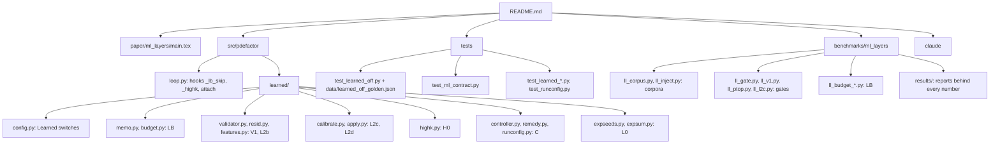

# MAP of `ml-layers`

| paper section | code | tests |
|---|---|---|
| 3 contract | `learned/config.py` | `test_learned_off.py`, `test_ml_contract.py` |
| 4 protocol | `ll_corpus.py`, `ll_inject.py`, `ll_gate.py` | `test_learned_inject.py` |
| 5 memo | `learned/memo.py` | `test_learned_budget.py` |
| 6 V1 | `learned/validator.py` | `test_learned_v1.py`, `test_learned_resid.py` |
| 7.1 LB skip | `learned/budget.py` | `test_learned_budget.py` |
| 7.2 L2b/c/d | `learned/ptop.py`, `calibrate.py` | `test_learned_ptop.py`, `test_learned_layers.py` |
| 7.4 C | `learned/controller.py` | `test_learned_controller.py`, `test_runconfig.py` |
