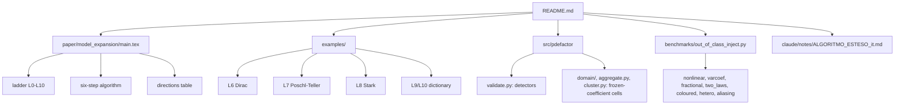

# MAP of `model-expansion`

| paper | where |
|---|---|
| section 2 vocabulary | notes, spec section 0 |
| section 3 algorithm | notes, spec sections 1-8 |
| section 5 examples | `examples/*.py`, `tests/test_examples.py` |
| section 6 route | `src/pdefactor/validate.py`, `domain/`, `benchmarks/out_of_class_inject.py` |
