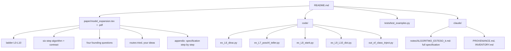

# MAP of `model-expansion`

| paper section | where |
|---|---|
| vocabulary, ladder, six steps | spec sections 0-8 (`claude/notes/ALGORITMO_ESTESO_it.md`) |
| four questions, encoders, boundary theorems | `analytical` branch: `claude/notes/SYNTHESIS-2.md`, `claude/proofs/S8-*.md` |
| routes, your ideas | `analytical` branch: `claude/notes/ROUTES.md`, `claude/archive/origin/piano_di_ricerca.md` |
| worked examples | `code/ex_*.py`, `tests/test_examples.py` |
| minimal route | `main` branch: `code/pdefactor/validate.py`, `domain/`; `code/out_of_class_inject.py` |
