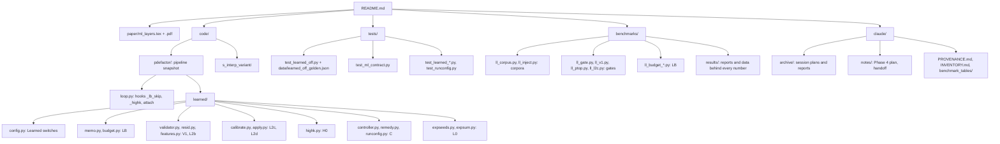

# MAP of `ml-layers`

| paper section | code | tests |
|---|---|---|
| pipeline and ML inside it | `code/pdefactor/{interp,aggregate,bayes_split,loop}.py` | `test_interp.py`, `test_aggregate_cluster.py`, `test_phase3.py`, `test_loop.py` |
| contract and protocol | `learned/config.py`, `benchmarks/ll_corpus.py`, `ll_inject.py` | `test_learned_off.py`, `test_learned_inject.py` |
| memo, V1, calibration, scan | `learned/{memo,budget,validator,calibrate,highk}.py` | `test_learned_budget.py`, `test_learned_v1.py`, `test_learned_ptop.py`, `test_learned_layers.py` |
| controller | `learned/{controller,remedy,runconfig}.py` | `test_learned_controller.py`, `test_runconfig.py` |
