# MAP of `main`

```mermaid
flowchart TD
  R[README.md] --> P[paper/]
  R --> S[src/pdefactor/]
  R --> T[tests/]
  R --> B[benchmarks/]
  R --> C[claude/]
  P --> PA[A_user_structure: theory first]
  P --> PB[B_proposed_structure: one idea first]
  P --> PS[shared/: sections, figures, experiments, refs.bib]
  PS --> PSS[sections/thy_*: theory]
  PS --> PSA[sections/alg_*: algorithm]
  PS --> PSB[sections/bayes*, bench, worked]
  S --> CORE[core/: variety, structfit, components, spectral, analyze]
  S --> LOOP[loop.py, refine_raw.py, bayes_split.py, raw_gof.py, validate.py]
  S --> INT[interp/: gp, epgp, ski, ensemble, reinterp]
  S --> DOM[domain/: quadtree, cell fits]
  S --> AGG[aggregate.py, cluster.py]
  S --> SIM[simulator.py, synthetic.py, symbols.py]
  S --> BASE[baselines/: sindy, dmd]
  S --> LRN[learned/: see branch ml-layers]
  T --> TC[test_core_*: exact core]
  T --> TL[test_loop, test_refine_grid, test_validate]
  T --> TM[test_ml_contract: interface pin]
  B --> BF[final_report.py]
  B --> BR[p8_final_v5.md, e2e_summary.md]
```

## Paper section -> code -> test
| paper content | code | tests |
|---|---|---|
| interpolation of the field | `interp/` | `test_interp.py`, `test_p4_reinterp.py` |
| mode extraction (matrix pencil) | `core/spectral.py` | `test_core_exact.py` |
| structured fit of factors | `core/structfit.py`, `core/variety.py` | `test_core_v2.py`, `test_general.py` |
| components, separation | `core/components.py` | `test_core_exact.py` |
| outer loop, evidence, labels | `loop.py`, `refine_raw.py`, `raw_gof.py`, `validate.py` | `test_loop.py`, `test_validate.py`, `test_t10*.py` |
| clustering across samples | `bayes_split.py`, `aggregate.py`, `cluster.py` | `test_aggregate_cluster.py` |
| benchmark and baselines | `simulator.py`, `synthetic.py`, `baselines/` | `test_baselines_bench.py`, `test_bench_sigma.py` |
