# MAP of `analytical`

```mermaid
flowchart TD
  R[README.md] --> P[paper/analytical/main.tex]
  R --> PR[proofs/]
  R --> V[verification/]
  R --> T[tests/test_verification.py]
  R --> N[claude/notes/]
  P --> S1[sections/thy_ring, thy_ep, port_ode: algebra]
  P --> S2[sections/thy_factor, thy_cond, port_regularity: groups are factors]
  P --> S3[sections/thy_eint, port_terms, port_tdpt: interaction term]
  P --> S4[sections/thy_ident: identification and certificates]
  P --> S5[sections/port_nonlinear: Burgers, dictionary]
  P --> S6[sections/app_proofs: proofs]
  P --> S7[sections/part2_ch12..ch21: Part II, Phases 6-10]
  R --> CE[paper/analytical_complete: 117 pp paper + 263 pp proof catalogue]
  R --> AR[claude/archive: work, research, claims, inbox, origin]
  PR --> L[LEDGER.md: claim -> status]
  PR --> PP[29 PROOF_PACKAGE files]
  PR --> LN[lean/: formalised core]
  V --> VS[one folder per proof package]
  N --> NP[PROBLEM, ROUTES, PROBLEMI_APERTI, REPORT_FINALE, NOTAZIONE, BIBLIOGRAFIA]
```

| paper content | proof package | checks |
|---|---|---|
| identification, annihilator, EP | `proofs/C3.md`, `II.md`, `P4.md` | `verification/c12_catalog.py`, `C3/` |
| factor decomposition, overlap | `proofs/C1C2.md` | `verification/C1C2/` |
| stability, Friedrichs angle | `proofs/C1C2.md`, `P2.md` | `verification/P2/`, `OP-F5C/` |
| interaction term, cost, instability | `proofs/P1.md`, `P3.md` | `verification/P1/`, `P3/` |
| Burgers, shock, dictionary | `proofs/S4-TERM.md`, `S4-ID.md`, `S4-INTEG.md` | `verification/S4-*/` |
| beyond the paper (variable coefficients, systems, encoders) | `proofs/S8-*.md` | `verification/S8-*/` (see branch `model-expansion`) |
