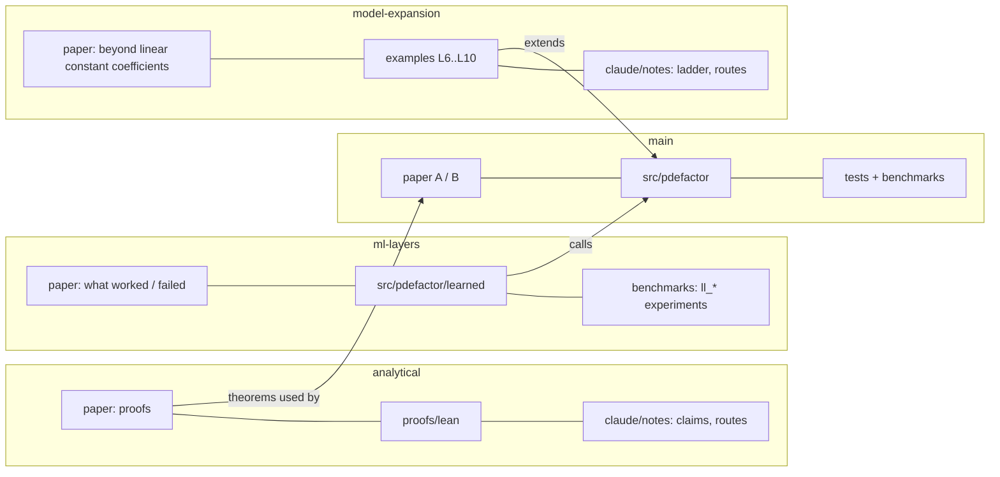

# MAP of the whole repository

| branch | read first | code | tests / benchmarks |
|---|---|---|---|
| `main` | `paper/B_proposed_structure/main.pdf` | `src/pdefactor/` | `tests/`, `benchmarks/` |
| `analytical` | `paper/analytical/main.pdf` | `proofs/`, `verification/` (symbolic checks) | Lean in `proofs/lean`, `tests/` |
| `ml-layers` | `paper/ml_layers/main.pdf` | `src/pdefactor/learned/` | `tests/test_learned*.py`, `benchmarks/` |
| `model-expansion` | `paper/model_expansion/main.pdf` | `examples/`, `benchmarks/out_of_class_inject.py` | `tests/test_examples.py` |

Each branch has `claude/CLAUDE.md` (rules), `claude/MAP.md` (graph), `claude/STATUS.md` (worked / did not work).

## History
The raw research history (all earlier sessions, logs, backups) is kept on the branches `archive/analytical`, `ml`, `other`, `larned-layers`, `final-report`, `phase4-ml-plan` until it is archived elsewhere. Nothing there is needed to use the repository.
