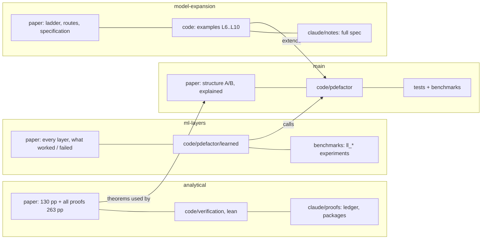

# MAP of the whole repository

| branch | read first | code | tests / benchmarks |
|---|---|---|---|
| `main` | `paper/structure_B.pdf` | `code/pdefactor/` | `tests/`, `benchmarks/` |
| `analytical` | `paper/analytical.pdf`, `paper/analytical_proofs.pdf` | `code/verification/`, `code/lean/` | `tests/test_verification.py` |
| `ml-layers` | `paper/ml_layers.pdf` | `code/pdefactor/learned/` | `tests/test_learned*.py`, `benchmarks/` |
| `model-expansion` | `paper/model_expansion.pdf` | `code/ex_*.py`, `code/out_of_class_inject.py` | `tests/test_examples.py` |

Every branch has the same skeleton: `paper/ code/ tests/ [benchmarks/] claude/`; `claude/` holds all markdown, `PROVENANCE.md` (where each file came from) and a map. The file/dependency graphs of the old and the new repository are in `claude/graph/` (rebuild with `code/tools/build_graph.py`); `claude/INVENTORY.md` compares them.

## History
The raw research history of the earlier repository is kept privately. Everything of value from it (papers, code, tests, benchmarks, plans, reports, audits) is in the four branches; `claude/INVENTORY.md` proves it.
